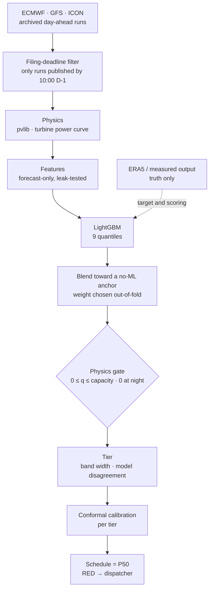
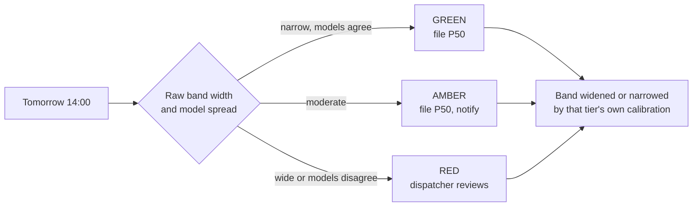

<div align="center">

# UrjaDrishti ಊರ್ಜಾ ದೃಷ್ಟಿ

Day-ahead solar and wind forecasts for Karnataka, with a calibrated range for every hour

[Design decisions](docs/BIBLE.md) · [What's real and what's simulated](docs/HONESTY.md) · [Build log](docs/BUILD_LOG.md) · [Benchmark plan](docs/BENCHMARK_PLAN.md)

</div>

## Overview

Solar and wind plants in Karnataka file an hour-by-hour schedule for the next day with the load despatch centre by
10:00 the day before. When a plant then delivers much more or much less than it scheduled, it pays for the gap under
CERC's deviation settlement rules. Most schedules come from one forecast number per hour, which gives no hint of
whether tomorrow afternoon is a safe bet or a monsoon coin-toss.

UrjaDrishti forecasts a range for each hour instead, and flags the hours where that range is wide. At four Karnataka
sites it was never trained on, its error was 6–9% lower than the best simple baseline, and its P10–P90 band covered
79–80% of hours against an 80% target. On measured output from the Belgian grid, the grid operator's own forecast
did better, with about 16% lower error.

Every number in this README is produced by a script and saved as JSON in [`results/`](results/). The held-out sites
and periods were chosen and committed before the model changes they test ([`docs/V3_SEAL.md`](docs/V3_SEAL.md)), and
each was scored once.

## What it does

For each plant and each hour of the next day, UrjaDrishti:

1. takes the forecasts that ECMWF, GFS and ICON had published by the 10:00 deadline, 24–48 hours ahead, and nothing
   published later;
2. turns that weather into megawatts, with pvlib for solar and a turbine power curve for wind;
3. predicts nine quantiles of output, P10 to P90, with LightGBM;
4. calibrates the P10–P90 band separately for GREEN, AMBER and RED hours;
5. files the median as the schedule and sends the RED hours to a dispatcher.

The same code runs on Belgian grid data as a check against measured output. The models have also been made smaller
and faster and benchmarked on a laptop CPU.

## Why it works

The physics does most of the work. The truth and the forecasts go through the same pvlib and power-curve models, so
LightGBM only has to learn how the weather forecast tends to be wrong at a given hour and season, not how a solar
plant behaves.

The inputs are limited to what a scheduler could actually have had. Each hour uses the newest weather-model run that
was started and published by 10:00 the previous day, and a test fails if a later run slips in. This costs some
accuracy: on the 2025–26 development year, solar error went from 4.96% to 5.36% and wind error from 4.37% to 4.57%,
compared with using the forecast from about a day earlier.

The three weather models are combined rather than trusted one at a time. How much they disagree is one of the signals
that decides an hour's tier, and the forecast is pulled toward either their average or a linear correction of them
(MOS), by a weight chosen from out-of-fold error over the training year. Two simpler ways of choosing that weight
failed first; [Layer 3](#layer-3-the-quantile-model) has the details.

The band is calibrated separately for each tier. Calibrated once for all hours, an 80% band gets its coverage right on
average but covers too little of the risky hours, which is where deviation charges come from. We call this the
Flat-Band Trap. In the development years, RED hours were 19–33% of all hours but held 67–76% of the energy that missed
the schedule by more than ±10%, and calibrating each tier on its own raised coverage in those hours by 9–12 points.

The schedule is a fixed rule: the median forecast, clipped to the plant's capacity, with RED hours flagged for a
person. No model decides what gets filed.

The results were checked against a second source of truth. Scored against NASA POWER satellite irradiance instead of
ERA5, the model still beat the average of the weather models by 3–10% at both solar sites. Comparing the two sources
also exposed a 30-minute timestamp bug, which was fixed before any held-out data was scored.

<details>
<summary>Prior work and citations</summary>

- Correcting weather-model output with regression is Model Output Statistics (Glahn & Lowry, 1972). The linear MOS
  baseline here is exactly that, and it's the one to beat.
- The band calibration is conformalized quantile regression (Romano, Patterson & Candès, 2019), done per group as
  Mondrian conformal prediction (Vovk, Gammerman & Shafer, 2005), with the groups matched to the operator's decision.
- The small network is trained by knowledge distillation (Hinton, Vinyals & Dean, 2015) from out-of-fold teacher
  predictions.
- Physics: pvlib (Holmgren, Hansen & Mikofski, 2018). Truth: ERA5 reanalysis (Hersbach et al., 2020) and NASA POWER.
- Deviation settlement: CERC (Deviation Settlement Mechanism and Related Matters) Regulations, 2024.

</details>

## How it works



For a single hour:



The code follows the same order: `urja/data → physics → features → models → uncertainty → decision → eval`.

| Area | Technology |
|---|---|
| Data | Open-Meteo previous-runs and archive APIs (ECMWF IFS 0.25°, GFS, ICON, ERA5), NASA POWER, Elia open data |
| Physics | pvlib (Ineichen clear sky, Erbs decomposition, SAPM cell temperature, PVWatts), IEC class-II power curve |
| Models | LightGBM quantile regression, ridge MOS, conformalized quantile regression (Mondrian) |
| Edge models | PyTorch quantile MLP, ONNX Runtime (fp32 / fp16 / int8), ExecuTorch + XNNPACK, treelite and lleaves compilation |
| Testing | pytest, Hypothesis property tests |

## The layers

### Layer 1: weather to megawatts

The truth and the forecasts go through the same physics, so the model only corrects forecast error. Solar is a
125 MWp / 100 MW AC plant:

$$P_{dc} = P_{dc,0}\,\frac{G_{poa}}{1000}\,\big(1 + \gamma\,(T_{cell} - 25)\big), \qquad P_{ac} = \min(0.96\,P_{dc},\ P_{ac,max})$$

Wind uses a generic class-II curve with cut-in 3 m/s, rated 12 m/s and cut-out 25 m/s:

$$P = 0.92\,P_{rated}\cdot \mathrm{clip}\!\left(\frac{v^3 - v_{in}^3}{v_{r}^3 - v_{in}^3},\,0,\,1\right) \quad \text{for } v_{in} \le v < v_{out}$$

Radiation is an average over the preceding hour, so the sun's position is taken at mid-hour. Using the timestamp
itself would shift the sun by 30 minutes and create a false morning and evening bias.

### Layer 2: only what existed at the deadline

Model runs start every 6 hours and become usable about 6 hours later. For an hour $t$ on day $D$, with the deadline
$d$ at 10:00 on $D-1$, we use the run from $N^*$ days earlier:

$$N^* = \min\{\,N : \lfloor t - 24N\,\text{h} \rfloor_{6\text{h}} + 6\,\text{h} \le d\,\}$$

In India that means the day-1 run for 00:30–04:30 and the day-2 run for every hour from 05:30 on. A property test
checks the rule on 200 random days. The 6-hour publication delay is an assumption ([build log](docs/BUILD_LOG.md)).

### Layer 3: the quantile model

There's one LightGBM per technology and quantile level (P10, P20, …, P90), trained on the training year only with fixed
hyper-parameters. The whole distribution is then shifted toward a no-ML anchor $a$: either the average of the three
physics forecasts, or a ridge correction of them (MOS):

$$\tilde q_\alpha = q_\alpha + w\,(a - q_{0.5})$$

The anchor and $w$ are chosen to minimise out-of-fold error over the training year, with folds blocked by month. Two
earlier ways of choosing $w$ failed. Fitting it on the calibration weeks pulled the Belgian solar forecast toward a
badly biased physics prior (error 4.35% → 5.50%), and about six weeks of data picked the wrong anchor for both Belgian
series ([build log](docs/BUILD_LOG.md)).

### Layer 4: tiers and per-tier calibration

Each hour's tier comes from its raw band width $w = q_{0.9} - q_{0.1}$ and the spread $r$ of the three physics
forecasts, both as fractions of capacity: RED if $w \ge 0.25$ or $r \ge 0.40$, AMBER if $w \ge 0.10$, otherwise GREEN.
Then, on held-out calibration weeks and for each tier $k$ separately:

$$E_i = \max(q_{0.1,i} - y_i,\ y_i - q_{0.9,i}), \qquad \hat Q_k = \text{the } \tfrac{\lceil (n_k+1)(1-\alpha) \rceil}{n_k}\text{ quantile of } \{E_i\}_{i \in k}$$

An hour in tier $k$ gets the band $[\,q_{0.1} - \hat Q_k,\ q_{0.9} + \hat Q_k\,]$, clipped to $[0, \text{capacity}]$.
The tier is set before calibration, from what's known when the forecast is made. The thresholds were set by hand on
development data.

### Layer 5: the schedule

The schedule is P50 × capacity, clipped to $[0, \text{capacity}]$, and zero for solar at night. RED hours are flagged
for review. Nothing in this rule is learned, and a test pins it.

### Layer 6: small models for the edge

For a device next to the plant, the trees are compiled to native code, and a small neural network is trained to copy
them (knowledge distillation) with

$$\mathcal L = \tfrac{1}{9}\sum_\alpha \rho_\alpha\!\left(y - q^{s}_\alpha\right) + \lambda\,\tfrac{1}{9}\sum_\alpha \left|q^{s}_\alpha - q^{t}_\alpha\right|, \qquad \lambda = 1$$

where $\rho_\alpha$ is the pinball loss, $q^s$ the student and $q^t$ the teacher's out-of-fold quantiles.

## Results

Errors are percentages of plant capacity (nMAE). Solar is scored on daylight hours only, because counting the night,
when every method is trivially right, would roughly halve every solar number. CRPS scores the whole distribution, and
lower is better. The tables are generated from [`results/`](results/) by `scripts/readme_numbers.py` and
`scripts/bench_report.py`.

<!-- numbers:start (generated by scripts/readme_numbers.py; do not edit) -->
### Sealed tests, scored once

Four Karnataka sites that no model or design choice had seen, Apr 2025 – Oct 2026, forecasts as available at the real filing deadline:

| Site | Model nMAE | Best baseline (nMAE) | vs best | P10–P90 coverage | RED-hour coverage | Hours marked RED |
|---|---|---|---|---|---|---|
| Raichur solar | **5.61%** | average of 3 weather models (6.13%) | **−8.5%** | 79.0% | 82.6% | 23% |
| Kalaburagi solar | **5.96%** | average of 3 weather models (6.49%) | **−8.1%** | 79.5% | 79.2% | 23% |
| Bagalkot wind | **4.51%** | linear MOS (4.78%) | **−5.8%** | 80.3% | 80.7% | 19% |
| Davanagere wind | **4.92%** | linear MOS (5.26%) | **−6.5%** | 80.0% | 76.5% | 20% |

Measured output from the Belgian grid operator Elia, Nov 2025 – Oct 2026, against Elia's own day-ahead forecast issued at 11:00 the day before:

| Series | Model nMAE | Elia nMAE | Linear MOS nMAE | Quantile score model / Elia | P10–P90 coverage model / Elia |
|---|---|---|---|---|---|
| Limburg solar (measured) | 3.76% | **3.15%** | 3.85% | 0.0246 / 0.0209 | 85.1% / 79.5% |
| Belgian offshore wind (measured) | 8.94% | **7.47%** | 10.55% | 0.0566 / 0.0480 | 74.9% / 76.2% |

### Tiers and the Flat-Band Trap (development years)

| Period · technology | Hours GREEN / AMBER / RED | RED share of out-of-band energy | RED-hour coverage, one band for all hours | RED-hour coverage, per tier |
|---|---|---|---|---|
| Apr–Oct 2025 · solar | 31% / 40% / 29% | **67%** | 73.4% | **83.9%** |
| Apr–Oct 2025 · wind | 34% / 33% / 33% | **76%** | 65.4% | **74.7%** |
| Nov 2025 – Oct 2026 · solar | 44% / 33% / 23% | **69%** | 73.5% | **85.3%** |
| Nov 2025 – Oct 2026 · wind | 57% / 24% / 19% | **72%** | 69.6% | **78.9%** |

### Development checks

| Check | Solar | Wind |
|---|---|---|
| Error with a ~24 h lead → with the real 10:00 filing deadline (Nov 2025 – Oct 2026) | 4.96% → 5.36% | 4.37% → 4.57% |
| Pavagada: model vs average of 3 weather models, scored on ERA5 / on NASA POWER satellite data | 5.63% vs 6.67% / 6.46% vs 7.20% | – |
| Koppal: model vs average of 3 weather models, scored on ERA5 / on NASA POWER satellite data | 5.50% vs 6.26% / 6.88% vs 7.08% | – |
| How far ERA5 and NASA POWER disagree with each other (nMAE) | 7.3%–7.6% | – |
<!-- numbers:end -->

The baseline in each row is the best of the no-ML baselines we computed, picked by code as the one with the lowest
error: the average of the three weather models, each model on its own, or a linear correction of them (MOS).

Elia's forecast beats ours on both Belgian series. Ours uses three free global weather models at a single grid point,
and it still beats linear MOS on both. Per-tier calibration left wind short of 80% coverage in RED hours during the
2025 monsoon (75%).

### CPU benchmarks and optimisation

<!-- bench:start (generated by scripts/bench_report.py; do not edit) -->
Measured on an Apple M4 (CPU features: FEAT_DotProd, FEAT_I8MM, FEAT_BF16, FEAT_SME, FEAT_SME2), on one thread, over the validation period (Apr–Oct 2025). The Raspberry Pi 5 benchmark hasn't been run yet. Latency is the median of at least 200 timed runs after warm-up, with p99 in brackets. Lower CRPS is better. The test list was written before measuring: [`docs/BENCHMARK_PLAN.md`](docs/BENCHMARK_PLAN.md).

**Solar: one plant-day forecast (24 hours, 9 quantiles)**

| Step | Size | Latency per plant-day | CRPS | Note |
|---|---|---|---|---|
| LightGBM 9 × 400 trees, Python API (starting point) | – | 11.14 ms (12.21 ms) | 0.0514 | 28,259 nodes |
| Smaller trees: 9 × 100 × 15 leaves (chosen on train-year out-of-fold CRPS) | – | 3.23 ms (3.68 ms) | 0.0515 | 4,933 nodes |
| …compiled to native code with treelite (C) | 734 KB | 247 µs (410 µs) | 0.0515 | identical outputs |
| …compiled with lleaves (LLVM) | – | 151 µs (308 µs) | 0.0515 | max Δ 1e-15 |
| mlp64_distilled (ONNX Runtime, fp32) | 30 KB | 22 µs (37 µs) | 0.0506 | max Δ 0.000 |
| mlp64_distilled (ONNX Runtime, fp16 weights) | 17 KB | 26 µs (29 µs) | 0.0507 | max Δ 0.001 |
| mlp64_distilled (ONNX Runtime, int8 dynamic) | 14 KB | 26 µs (33 µs) | 0.0506 | max Δ 0.011 |
| mlp64_distilled (ONNX Runtime, int8 static (QDQ, per-channel)) | 18 KB | 20 µs (21 µs) | 0.0513 | max Δ 0.082 |
| mlp64_distilled (ExecuTorch + XNNPACK, fp32) | 34 KB | 95 µs (171 µs) | 0.0506 | max Δ 0.000 |
| mlp64_distilled (ExecuTorch + XNNPACK, int8) | 17 KB | 99 µs (175 µs) | 0.0519 | max Δ 0.101 |

The compiled trees are 74× faster per plant-day than the starting point, with the same accuracy. The teacher (LightGBM 400×31) scores CRPS 0.0514.

| Student MLP | Params | MACs / row | CRPS plain | CRPS distilled |
|---|---|---|---|---|
| 16 hidden units | 1,001 | 960 | 0.0538 | 0.0519 |
| 32 hidden units | 2,505 | 2,432 | 0.0521 | 0.0512 |
| 64 hidden units | 7,049 | 6,912 | 0.0561 | 0.0506 |
| 128 hidden units | 22,281 | 22,016 | 0.0605 | 0.0515 |
| 256 hidden units | 77,321 | 76,800 | 0.0625 | 0.0509 |

Pruning a distilled 128-unit network to 64 units, then fine-tuning for 15 epochs, gives CRPS 0.0512 vs 0.0506 for a 64-unit network distilled from scratch.

Thread scaling (ONNX fp32, batches of 10 000): 1 thread 4.1 M rows/s, 2 threads 6.1 M rows/s, 4 threads 8.1 M rows/s

**Wind: one plant-day forecast (24 hours, 9 quantiles)**

| Step | Size | Latency per plant-day | CRPS | Note |
|---|---|---|---|---|
| LightGBM 9 × 400 trees, Python API (starting point) | – | 9.70 ms (10.67 ms) | 0.0484 | 21,761 nodes |
| Smaller trees: 9 × 100 × 15 leaves (chosen on train-year out-of-fold CRPS) | – | 2.84 ms (3.67 ms) | 0.0484 | 3,702 nodes |
| …compiled to native code with treelite (C) | 686 KB | 223 µs (299 µs) | 0.0484 | identical outputs |
| …compiled with lleaves (LLVM) | – | 127 µs (197 µs) | 0.0484 | max Δ 9e-16 |
| mlp32_plain (ONNX Runtime, fp32) | 12 KB | 19 µs (21 µs) | 0.0488 | max Δ 0.000 |
| mlp32_plain (ONNX Runtime, fp16 weights) | 8 KB | 25 µs (25 µs) | 0.0487 | max Δ 0.002 |
| mlp32_plain (ONNX Runtime, int8 dynamic) | 9 KB | 25 µs (30 µs) | 0.0499 | max Δ 0.020 |
| mlp32_plain (ONNX Runtime, int8 static (QDQ, per-channel)) | 13 KB | 18 µs (19 µs) | 0.0507 | max Δ 0.132 |
| mlp32_plain (ExecuTorch + XNNPACK, fp32) | 16 KB | 58 µs (109 µs) | 0.0488 | max Δ 0.000 |
| mlp32_plain (ExecuTorch + XNNPACK, int8) | 12 KB | 57 µs (110 µs) | 0.0505 | max Δ 0.055 |

The compiled trees are 77× faster per plant-day than the starting point, with the same accuracy. The teacher (LightGBM 400×31) scores CRPS 0.0484.

| Student MLP | Params | MACs / row | CRPS plain | CRPS distilled |
|---|---|---|---|---|
| 16 hidden units | 1,001 | 960 | 0.0488 | 0.0530 |
| 32 hidden units | 2,505 | 2,432 | 0.0488 | 0.0541 |
| 64 hidden units | 7,049 | 6,912 | 0.0535 | 0.0544 |
| 128 hidden units | 22,281 | 22,016 | 0.0542 | 0.0537 |
| 256 hidden units | 77,321 | 76,800 | 0.0541 | 0.0535 |

Pruning a distilled 128-unit network to 64 units, then fine-tuning for 15 epochs, gives CRPS 0.0531 vs 0.0544 for a 64-unit network distilled from scratch.

Thread scaling (ONNX fp32, batches of 10 000): 1 thread 5.0 M rows/s, 2 threads 7.5 M rows/s, 4 threads 10.3 M rows/s

**Where int8 starts to pay off on this CPU** (batches of 1 024, random weights, latency only)

| Hidden units | MACs / row | fp32 | int8 dynamic | int8 speed-up | ExecuTorch fp32 | ExecuTorch int8 |
|---|---|---|---|---|---|---|
| 64 | 6,848 | 261 µs | 416 µs | 0.63× | 489 µs | 498 µs |
| 256 | 76,544 | 615 µs | 942 µs | 0.65× | 613 µs | 596 µs |
| 1024 | 1,092,608 | 3.53 ms | 3.73 ms | 0.95× | 2.28 ms | 1.43 ms |
| 2048 | 4,282,368 | 16.67 ms | 9.30 ms | 1.79× | 9.47 ms | 3.90 ms |
<!-- bench:end -->

Most of the speed-up came from compiling the trees to native code: they produce a plant-day about 75× faster than
through LightGBM's Python API, with identical outputs. On solar, a 30 KB network trained to copy the trees scored CRPS
0.0506 against their 0.0514; on wind, distillation made every width worse, so the deployed network is a plain one.
Quantisation mattered less. On this CPU, int8 only pays off once layers reach about 1,000 units, so fp32 is the right
choice for a 30 KB model.

The benchmark also caught a numerics bug. Converting the wind network to fp16 silently broke it (CRPS 0.049 → 0.507):
a constant input feature had a standard deviation of about 1e-6, and the normalisation overflowed in fp16. Standard
deviations are now floored ([build log](docs/BUILD_LOG.md)).

## Project structure

```
urja/data/          fetching: archived forecasts, ERA5, NASA POWER, Elia; the filing-deadline rule (lead.py)
urja/physics/       pvlib plant and turbine power curve
urja/features/      the forecast-only feature table and the time splits
urja/models/        LightGBM quantiles + anchor blend + conformal calibration; the small quantile MLP
urja/uncertainty/   GREEN / AMBER / RED tiers
urja/decision/      the fixed-rule schedule
urja/eval/          evaluation, including the sealed one-shot scoring
urja/edge/, bench/  CPU benchmarks: compilation, distillation, pruning, quantisation, ExecuTorch
scripts/            reproduce.sh, README number generators, Raspberry Pi benchmark
results/            the JSON behind every number in this README
docs/               design decisions, honesty inventory, build log, benchmark plan, the seal
tests/              pytest and Hypothesis tests
```

## Installation

```bash
git clone https://github.com/ArushJain-697/UrjaDrishti.git && cd UrjaDrishti
bash scripts/reproduce.sh        # venv, fetch (~2 min, public APIs, no keys), train, evaluate, test
```

After the first fetch, everything runs offline from `data/raw/`.

```bash
python -m urja.eval.v3            # development report: lead-time cost, second truth, measured output
python -m urja.bench.trees        # tree benchmarks (LightGBM process)
python -m urja.bench.nets         # neural-net benchmarks (PyTorch process)
```

LightGBM and PyTorch run in separate processes, because on macOS their OpenMP runtimes deadlock together.

## Testing

```bash
python -m pytest -q               # 11 tests, including property tests with generated cases
```

| Test | What it checks |
|---|---|
| `test_no_truth_leaks_into_features` | Scrambling the truth data changes the target but not a single feature value |
| `test_filed_lead_never_uses_a_run_published_after_the_deadline` | No hour uses a weather run published after the deadline (200 generated days) |
| `test_karnataka_rows_sit_on_true_utc_hours` | The 30-minute timestamp bug stays fixed |
| `test_gate_never_emits_impossible_power` | Quantiles never cross or leave [0, capacity], and solar is 0 at night (300 generated cases) |
| `test_tier_is_monotone_in_uncertainty` | More uncertainty never makes an hour look safer (500 generated cases) |
| `test_splits_are_time_ordered_and_sealed` | Training, calibration and test periods are in time order and don't overlap |

## Glossary

| Term | Meaning |
|---|---|
| nMAE | Mean absolute error as a fraction of plant capacity |
| CRPS | Continuous ranked probability score: how good a whole forecast distribution is (lower is better) |
| P10 / P50 / P90 | Output levels the plant should fall below 10%, 50% and 90% of the time |
| NWP | Numerical weather prediction: a global weather model's forecast |
| MOS | Model output statistics: a regression that corrects weather-model output |
| Filing deadline | 10:00 on the day before, when tomorrow's schedule is due |
| Conformal calibration | Widening or narrowing a band using held-out errors, so its coverage is earned rather than assumed |
| Mondrian | Conformal calibration done separately for each group (here, each tier) |
| Flat-Band Trap | A band that is right on average but too narrow on the risky hours |
| Distillation | Training a small model to copy a larger model's outputs |

## Documentation

- [`docs/BIBLE.md`](docs/BIBLE.md): design, the trap, positioning and likely questions
- [`docs/HONESTY.md`](docs/HONESTY.md): what each component really is: real, simulated or assumed
- [`docs/BUILD_LOG.md`](docs/BUILD_LOG.md): what went wrong and how it was found
- [`docs/V3_SEAL.md`](docs/V3_SEAL.md): the held-out tests, written down before the code
- [`docs/BENCHMARK_PLAN.md`](docs/BENCHMARK_PLAN.md): the CPU test list, written before measuring

## Known limitations

- Karnataka plant output is simulated. Plant-level SCADA data isn't public, so "actual" output is ERA5 weather run
  through the same physics. The forecast error the model learns is real, but plant behaviour (soiling, outages,
  curtailment, real turbine curves) is not. The Belgian check uses measured output, though Elia's solar values are
  themselves upscaled from sampled installations.
- Capacities are modelled 100 MW blocks at real locations, not the real plants' nameplate.
- One weather grid point stands in for each Belgian series, which covers a whole province or offshore zone.
- The unseen sites share years and weather with the training sites, so they test transfer across places, not across
  time. A later period, from November 2026, is sealed for that.
- The deviation cost is a proxy: energy outside a ±10% band. The real CERC settlement uses capacity-based bands that
  changed on 1 April 2026.
- The run publication delay is assumed to be 6 hours after a run starts. The real delay varies by model.
- CPU numbers are from one Apple M4 laptop on one thread. Energy isn't measured, and the Raspberry Pi 5 numbers need
  `scripts/bench_pi.sh` run on the board.
