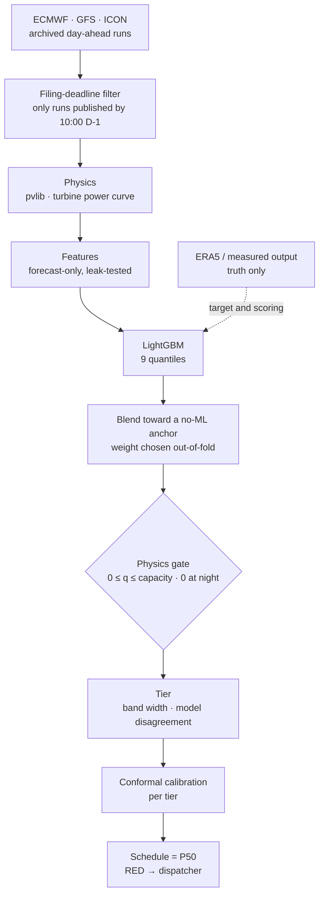
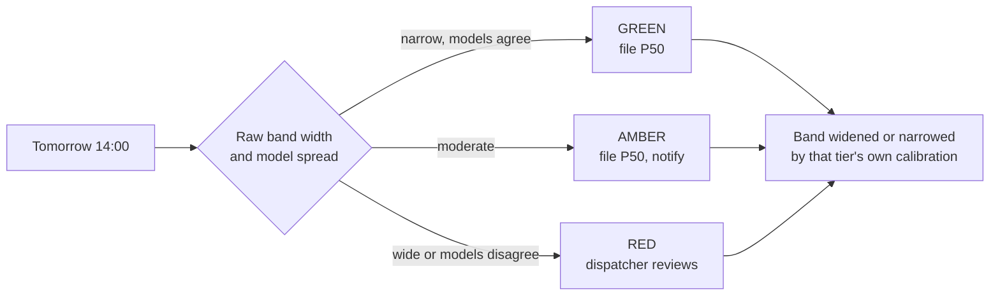

<div align="center">

# UrjaDrishti ಊರ್ಜಾ ದೃಷ್ಟಿ

**Day-ahead solar and wind forecasts that say how sure they are, hour by hour**

*Probabilistic generation forecasts for Karnataka from real archived weather forecasts, with calibrated
P10–P90 bands and a deterministic schedule that sends only the risky hours to a person*

[Design decisions](docs/BIBLE.md) · [What is real and what is simulated](docs/HONESTY.md) · [Build log](docs/BUILD_LOG.md) · [Benchmark plan](docs/BENCHMARK_PLAN.md)

</div>

---

## Overview

Every morning a solar or wind generator in Karnataka files the next day's hour-by-hour schedule with the load
despatch centre. If the plant then delivers much more or much less than it scheduled, it pays for the gap under
CERC's deviation settlement rules. The forecast behind that schedule is usually one number per hour. It says
nothing about whether tomorrow afternoon is a safe bet or a monsoon coin-toss.

UrjaDrishti forecasts the whole distribution instead. For every plant and every hour of the next day it:

1. Takes what three global weather models (ECMWF, GFS, ICON) had published by the filing deadline, 10:00 the day
   before. Nothing published later is used.
2. Turns that weather into megawatts with physics (sun position, panel temperature, inverter limits, a turbine
   power curve).
3. Learns how wrong that physics forecast tends to be, and predicts nine quantiles of output, P10 to P90.
4. Calibrates the P10–P90 band separately for calm, uncertain and risky hours, so the band means what it says.
5. Marks each hour GREEN, AMBER or RED, and files the median as the schedule. RED hours go to a dispatcher.
   No model decides what gets filed.

Every number in this README comes from a script and a JSON file in [`results/`](results/). The held-out tests were
written down and committed before the code they test ([`docs/V3_SEAL.md`](docs/V3_SEAL.md)), and each was
scored once. We kept the results that went against us. On measured output from the Belgian grid, the grid operator's
own forecast beats ours by 16–20%, and that is in the table below.

## Features

| Capability | Description |
|---|---|
| Real forecast inputs | Archived day-ahead runs of ECMWF IFS, GFS and ICON, as available at the 10:00 filing deadline (24–48 h ahead) |
| Physics first | pvlib (sun position, irradiance transposition, cell temperature, inverter clipping) and a turbine power curve |
| Full distribution | LightGBM predicts 9 quantiles per plant-hour, shifted toward a no-ML anchor by a weight chosen out-of-fold |
| Honest bands | Conformalized quantile regression, calibrated **separately for each confidence tier** |
| Confidence tiers | GREEN / AMBER / RED per hour, from signals known when the forecast is made |
| Deterministic schedule | Schedule = P50; RED hours need a dispatcher's review before filing |
| Two independent truths | Solar scored against ERA5 reanalysis and against NASA POWER satellite irradiance |
| Measured-output check | The same method on Belgian grid data, against measured output and the operator's own forecast |
| Small and fast | Trees compiled to native code (~75× faster), and a 30 KB distilled neural net, benchmarked on CPU |
| Replay desk | A dashboard of every development day, hardest first, with the tier strip and a live Flat-Band toggle |

> **Decision:** the forecast is held to the real filing deadline, not to "the weather forecast from about a day
> earlier". For each hour we use the newest model run that had been started and published (we assume 6 h) by 10:00 the
> previous day. That means the day-2 run for every hour from 05:30 on. It costs accuracy, and we report how much
> (error up about 5–8% on development data). [Why →](docs/BUILD_LOG.md)

---

## The problem

| What a scheduler needs | What UrjaDrishti delivers |
|---|---|
| A schedule filed by 10:00 for every hour of tomorrow | P50 per hour, from forecasts that existed at 10:00 (a test checks that no later run is ever used) |
| To know which hours are risky | A GREEN / AMBER / RED tier per hour; RED hours carry most of the deviation risk (table below) |
| A band that means what it says | P10–P90 bands calibrated per tier; on unseen sites they cover 79–80% of hours against an 80% target |
| No cloud dependency at the plant | A model small and fast enough for a substation box (benchmarks below) |
| Numbers that hold up | Held-out sites and a measured-output check, both sealed before the code and scored once |

---

## What makes it different

1. **The band is honest where it matters.** An 80% band calibrated on all hours at once borrows its coverage from
   easy hours. It is too wide on calm hours and too narrow on exactly the hours that cost money. We call this the
   **Flat-Band Trap**. UrjaDrishti decides each hour's tier *before* calibration and calibrates each tier on its own.
2. **The model never files the schedule.** The schedule is a fixed rule over the calibrated distribution, and RED
   hours go to a person.
3. **It is only allowed to know what a scheduler knew.** Every input is a forecast that had been published by the
   filing deadline. A test scrambles the truth data and checks that no feature changes.
4. **It is checked against reality twice.** Once against a second, independent truth (satellite irradiance), and
   once against measured output with the grid operator's own forecast as the opponent.

> **Decision:** the second truth paid for itself before it scored anything. Lining NASA POWER up against ERA5
> exposed a half-hour offset: asked for India time, the weather API shifts its data by 5 h but labels it +05:30, so
> every row was 30 minutes early. Everything is now fetched in UTC and converted locally, and a test guards it.
> [Why →](docs/BUILD_LOG.md)

---

## Architecture

### End-to-end pipeline



### What happens to one hour



The folder tree follows the diagram: `urja/data → physics → features → models → uncertainty → decision → eval`.

---

## Tech Stack

| Area | Technology |
|---|---|
| Data | Open-Meteo previous-runs and archive APIs (ECMWF IFS 0.25°, GFS, ICON, ERA5), NASA POWER, Elia open data |
| Physics | pvlib (Ineichen clear sky, Erbs decomposition, SAPM cell temperature, PVWatts), IEC class-II power curve |
| Models | LightGBM quantile regression, ridge MOS, conformalized quantile regression (Mondrian) |
| Edge models | PyTorch quantile MLP, ONNX Runtime (fp32 / fp16 / int8), ExecuTorch + XNNPACK, treelite and lleaves compilation |
| Serving | FastAPI (read-only), React + Vite dashboard |
| Testing | pytest, Hypothesis property tests |

---

## Deep Dive: The Layers

### Layer 1: weather to megawatts

The same physics turns both the truth and the forecasts into power, so the learned model's only job is correcting
forecast error. Solar uses a 125 MWp / 100 MW AC plant:

$$P_{dc} = P_{dc,0}\,\frac{G_{poa}}{1000}\,\big(1 + \gamma\,(T_{cell} - 25)\big), \qquad P_{ac} = \min(0.96\,P_{dc},\ P_{ac,max})$$

Wind uses a generic class-II curve with cut-in 3 m/s, rated 12 m/s and cut-out 25 m/s:

$$P = 0.92\,P_{rated}\cdot \mathrm{clip}\!\left(\frac{v^3 - v_{in}^3}{v_{r}^3 - v_{in}^3},\,0,\,1\right) \quad \text{for } v_{in} \le v < v_{out}$$

> **Decision:** radiation is an average over the preceding hour, so the sun's position is taken at mid-hour. Using
> the timestamp itself shifts the sun by 30 minutes and creates a false morning and evening bias.

### Layer 2: only what existed at the deadline

Model runs start every 6 hours and become usable about 6 hours later. For an hour $t$ on day $D$, with deadline
$d = $ 10:00 on $D-1$, we use the run from $N^*$ days earlier:

$$N^* = \min\{\,N : \lfloor t - 24N\,\text{h} \rfloor_{6\text{h}} + 6\,\text{h} \le d\,\}$$

In India this gives the day-1 run for 00:30–04:30 and the day-2 run for every later hour. A property test checks the
rule on 200 random days.

### Layer 3: the quantile model

One LightGBM per technology and quantile level (P10, P20, …, P90), trained on the training year only, with fixed
hyper-parameters. The whole distribution is then shifted toward a no-ML anchor $a$, either the average of the three
physics forecasts or a ridge correction of them (MOS):

$$\tilde q_\alpha = q_\alpha + w\,(a - q_{0.5})$$

The anchor and $w$ are chosen to minimise out-of-fold error on the training year (month-blocked folds).

> **Decision:** the first two ways of choosing $w$ failed. Fitting it on the calibration weeks pulled the Belgian
> solar forecast toward a badly biased physics prior (error 4.35% → 5.50%), and about six weeks of data picked the
> wrong anchor for both Belgian series. Out-of-fold selection over a whole year fixed both. [Why →](docs/BUILD_LOG.md)

### Layer 4: tiers and per-tier calibration

Each hour's tier comes from its raw band width $w = q_{0.9} - q_{0.1}$ and the spread $r$ of the three physics
forecasts, both in capacity units: RED if $w \ge 0.25$ or $r \ge 0.40$, AMBER if $w \ge 0.10$, otherwise GREEN.
Then, on held-out calibration weeks, for each tier $k$ separately:

$$E_i = \max(q_{0.1,i} - y_i,\ y_i - q_{0.9,i}), \qquad \hat Q_k = \text{the } \tfrac{\lceil (n_k+1)(1-\alpha) \rceil}{n_k}\text{ quantile of } \{E_i\}_{i \in k}$$

and the band for an hour in tier $k$ is $[\,q_{0.1} - \hat Q_k,\ q_{0.9} + \hat Q_k\,]$, clipped to $[0, \text{capacity}]$.

> **Decision:** the tier is decided before calibration, from things known when the forecast is made. If it were
> decided from the calibrated band, the tiers and the corrections would chase each other.

### Layer 5: the schedule

Schedule = P50 × capacity, clipped to $[0, \text{capacity}]$, zero for solar at night; RED hours are flagged for
review. Nothing about this rule is learned, and a test pins it.

### Layer 6: small models for the edge

For a device next to the plant, the trees are compiled to native code, and a small neural network is trained to copy
them (knowledge distillation) with

$$\mathcal L = \tfrac{1}{9}\sum_\alpha \rho_\alpha\!\left(y - q^{s}_\alpha\right) + \lambda\,\tfrac{1}{9}\sum_\alpha \left|q^{s}_\alpha - q^{t}_\alpha\right|, \qquad \lambda = 1$$

where $\rho_\alpha$ is the pinball loss, $q^s$ the student and $q^t$ the teacher's out-of-fold quantiles.

---

## Benchmarks

All errors are % of plant capacity (nMAE). Solar is scored on daylight hours only: counting night, when every method
is trivially right, would roughly halve every solar number. CRPS scores the whole distribution (lower is better).
Every table in this section is generated from [`results/`](results/) by `scripts/readme_numbers.py` and
`scripts/bench_report.py`.

<!-- numbers:start (generated by scripts/readme_numbers.py; do not edit) -->
### Sealed tests, scored once

Four Karnataka sites that no model or design choice had seen, Apr 2025 – Oct 2026, forecasts as available at the real filing deadline:

| Site | Model nMAE | Best baseline (nMAE) | vs best | P10–P90 coverage | RED-hour coverage | Hours marked RED |
|---|---|---|---|---|---|---|
| Raichur solar | **5.61%** | average of 3 weather models (6.13%) | **−8.5%** | 79.0% | 82.6% | 23% |
| Kalaburagi solar | **5.96%** | average of 3 weather models (6.49%) | **−8.1%** | 79.5% | 79.2% | 23% |
| Bagalkot wind | **4.51%** | linear MOS (4.78%) | **−5.8%** | 80.3% | 80.7% | 19% |
| Davanagere wind | **4.92%** | linear MOS (5.26%) | **−6.5%** | 80.0% | 76.5% | 20% |

Measured output from the Belgian grid operator Elia, Nov 2025 – Oct 2026, against Elia's own day-ahead forecast issued at 11:00 the day before:

| Series | Model nMAE | Elia nMAE | Linear MOS nMAE | Quantile score model / Elia | P10–P90 coverage model / Elia |
|---|---|---|---|---|---|
| Limburg solar (measured) | 3.76% | **3.15%** | 3.85% | 0.0246 / 0.0209 | 85.1% / 79.5% |
| Belgian offshore wind (measured) | 8.94% | **7.47%** | 10.55% | 0.0566 / 0.0480 | 74.9% / 76.2% |

### Tiers and the Flat-Band Trap (development years)

| Period · technology | Hours GREEN / AMBER / RED | RED share of out-of-band energy | RED-hour coverage, one band for all hours | RED-hour coverage, per tier |
|---|---|---|---|---|
| Apr–Oct 2025 · solar | 31% / 40% / 29% | **67%** | 73.4% | **83.9%** |
| Apr–Oct 2025 · wind | 34% / 33% / 33% | **76%** | 65.4% | **74.7%** |
| Nov 2025 – Oct 2026 · solar | 44% / 33% / 23% | **69%** | 73.5% | **85.3%** |
| Nov 2025 – Oct 2026 · wind | 57% / 24% / 19% | **72%** | 69.6% | **78.9%** |

### Development checks

| Check | Solar | Wind |
|---|---|---|
| Error with a ~24 h lead → with the real 10:00 filing deadline (Nov 2025 – Oct 2026) | 4.96% → 5.36% | 4.37% → 4.57% |
| Pavagada: model vs average of 3 weather models, scored on ERA5 / on NASA POWER satellite data | 5.63% vs 6.67% / 6.46% vs 7.20% | – |
| Koppal: model vs average of 3 weather models, scored on ERA5 / on NASA POWER satellite data | 5.50% vs 6.26% / 6.88% vs 7.08% | – |
| How far ERA5 and NASA POWER disagree with each other (nMAE) | 7.3%–7.6% | – |
<!-- numbers:end -->

> **Decision:** the tiers are where the value is. The hours marked RED are 19–33% of all hours but hold 67–76% of
> the energy that missed the schedule by more than ±10%. Calibrating each tier on its own lifts coverage in those RED
> hours by 9–12 points. It is still short of 80% for wind in the 2025 monsoon (75%), and the table shows that.

> **Decision:** we compare against the strongest baseline an operator could actually use, picked by code as the one
> with the lowest error. Here that is either the average of the three weather models or a linear correction of them
> (MOS), never persistence. At all four unseen sites the model beats it by 6–9%.

> **Decision:** we kept the measured-output result that went against us. The Belgian grid operator's own forecast is
> 16–20% better than ours on point error. It has far more information than three free global weather models at a
> single grid point. Ours still beats the linear MOS baseline on both series.

### CPU benchmarks and optimisation

<!-- bench:start (generated by scripts/bench_report.py; do not edit) -->
Measured on **Apple M4** (CPU features: FEAT_DotProd, FEAT_I8MM, FEAT_BF16, FEAT_SME, FEAT_SME2), one thread, validation split (Apr–Oct 2025). Latency is p50 over ≥ 200 timed runs after warm-up; p99 in brackets. CRPS: lower is better. Plan written before measuring: [`docs/BENCHMARK_PLAN.md`](docs/BENCHMARK_PLAN.md).

**Solar: one plant-day forecast (24 hours, 9 quantiles)**

| Step | Size | Latency per plant-day | CRPS | Note |
|---|---|---|---|---|
| LightGBM 9 × 400 trees, Python API (starting point) | – | 11.14 ms (12.21 ms) | 0.0514 | 28,259 nodes |
| Smaller trees: 9 × 100 × 15 leaves (chosen on train-year out-of-fold CRPS) | – | 3.23 ms (3.68 ms) | 0.0515 | 4,933 nodes |
| …compiled to native code with treelite (C) | 734 KB | 247 µs (410 µs) | 0.0515 | identical outputs |
| …compiled with lleaves (LLVM) | – | 151 µs (308 µs) | 0.0515 | max Δ 1e-15 |
| mlp64_distilled (ONNX Runtime, fp32) | 30 KB | 22 µs (37 µs) | 0.0506 | max Δ 0.000 |
| mlp64_distilled (ONNX Runtime, fp16 weights) | 17 KB | 26 µs (29 µs) | 0.0507 | max Δ 0.001 |
| mlp64_distilled (ONNX Runtime, int8 dynamic) | 14 KB | 26 µs (33 µs) | 0.0506 | max Δ 0.011 |
| mlp64_distilled (ONNX Runtime, int8 static (QDQ, per-channel)) | 18 KB | 20 µs (21 µs) | 0.0513 | max Δ 0.082 |
| mlp64_distilled (ExecuTorch + XNNPACK, fp32) | 34 KB | 95 µs (171 µs) | 0.0506 | max Δ 0.000 |
| mlp64_distilled (ExecuTorch + XNNPACK, int8) | 17 KB | 99 µs (175 µs) | 0.0519 | max Δ 0.101 |

Trees: **74× faster** per plant-day than the starting point with the same accuracy. Teacher (LightGBM 400×31) CRPS 0.0514.

| Student MLP | Params | MACs / row | CRPS plain | CRPS distilled |
|---|---|---|---|---|
| 16 hidden units | 1,001 | 960 | 0.0538 | 0.0519 |
| 32 hidden units | 2,505 | 2,432 | 0.0521 | 0.0512 |
| 64 hidden units | 7,049 | 6,912 | 0.0561 | 0.0506 |
| 128 hidden units | 22,281 | 22,016 | 0.0605 | 0.0515 |
| 256 hidden units | 77,321 | 76,800 | 0.0625 | 0.0509 |

Structured pruning, distilled 128 → 64 units + 15 fine-tune epochs: CRPS 0.0512 vs 0.0506 for a 64-unit model distilled from scratch.

Thread scaling (ONNX fp32, batch 10 000): 1 thread 4.1 M rows/s, 2 threads 6.1 M rows/s, 4 threads 8.1 M rows/s

**Wind: one plant-day forecast (24 hours, 9 quantiles)**

| Step | Size | Latency per plant-day | CRPS | Note |
|---|---|---|---|---|
| LightGBM 9 × 400 trees, Python API (starting point) | – | 9.70 ms (10.67 ms) | 0.0484 | 21,761 nodes |
| Smaller trees: 9 × 100 × 15 leaves (chosen on train-year out-of-fold CRPS) | – | 2.84 ms (3.67 ms) | 0.0484 | 3,702 nodes |
| …compiled to native code with treelite (C) | 686 KB | 223 µs (299 µs) | 0.0484 | identical outputs |
| …compiled with lleaves (LLVM) | – | 127 µs (197 µs) | 0.0484 | max Δ 9e-16 |
| mlp32_plain (ONNX Runtime, fp32) | 12 KB | 19 µs (21 µs) | 0.0488 | max Δ 0.000 |
| mlp32_plain (ONNX Runtime, fp16 weights) | 8 KB | 25 µs (25 µs) | 0.0487 | max Δ 0.002 |
| mlp32_plain (ONNX Runtime, int8 dynamic) | 9 KB | 25 µs (30 µs) | 0.0499 | max Δ 0.020 |
| mlp32_plain (ONNX Runtime, int8 static (QDQ, per-channel)) | 13 KB | 18 µs (19 µs) | 0.0507 | max Δ 0.132 |
| mlp32_plain (ExecuTorch + XNNPACK, fp32) | 16 KB | 58 µs (109 µs) | 0.0488 | max Δ 0.000 |
| mlp32_plain (ExecuTorch + XNNPACK, int8) | 12 KB | 57 µs (110 µs) | 0.0505 | max Δ 0.055 |

Trees: **77× faster** per plant-day than the starting point with the same accuracy. Teacher (LightGBM 400×31) CRPS 0.0484.

| Student MLP | Params | MACs / row | CRPS plain | CRPS distilled |
|---|---|---|---|---|
| 16 hidden units | 1,001 | 960 | 0.0488 | 0.0530 |
| 32 hidden units | 2,505 | 2,432 | 0.0488 | 0.0541 |
| 64 hidden units | 7,049 | 6,912 | 0.0535 | 0.0544 |
| 128 hidden units | 22,281 | 22,016 | 0.0542 | 0.0537 |
| 256 hidden units | 77,321 | 76,800 | 0.0541 | 0.0535 |

Structured pruning, distilled 128 → 64 units + 15 fine-tune epochs: CRPS 0.0531 vs 0.0544 for a 64-unit model distilled from scratch.

Thread scaling (ONNX fp32, batch 10 000): 1 thread 5.0 M rows/s, 2 threads 7.5 M rows/s, 4 threads 10.3 M rows/s

**Where int8 starts to pay off on this CPU** (ONNX Runtime, batch 1 024, random weights, latency only)

| Hidden units | MACs / row | fp32 | int8 dynamic | int8 speed-up | ExecuTorch fp32 | ExecuTorch int8 |
|---|---|---|---|---|---|---|
| 64 | 6,848 | 261 µs | 416 µs | 0.63× | 489 µs | 498 µs |
| 256 | 76,544 | 615 µs | 942 µs | 0.65× | 613 µs | 596 µs |
| 1024 | 1,092,608 | 3.53 ms | 3.73 ms | 0.95× | 2.28 ms | 1.43 ms |
| 2048 | 4,282,368 | 16.67 ms | 9.30 ms | 1.79× | 9.47 ms | 3.90 ms |
<!-- bench:end -->

> **Decision:** the biggest speed-up was not quantisation, it was the runtime. Compiled to native code, the same
> trees answer a plant-day about 75× faster than through LightGBM's Python API, with identical outputs. int8 only
> pays off once layers reach about 1,000 units, so for a 30 KB model fp32 is the right choice.

> **Decision:** the benchmark caught a numerics bug. Converting the wind network to fp16 silently broke it (CRPS
> 0.049 → 0.507): a constant input feature had a standard deviation of about 1e-6, and the normalisation overflowed
> in fp16. Standard deviations are now floored. [Why →](docs/BUILD_LOG.md)

---

## Positioning against prior work

- Correcting weather-model output with statistics is decades old: Model Output Statistics (Glahn & Lowry, 1972). Our
  linear MOS baseline is exactly that, and it is the baseline we have to beat.
- Calibrated probabilistic forecasts from weather ensembles are standard in meteorology (e.g. EMOS, Gneiting et al.,
  2005). UrjaDrishti works from only three deterministic models, so it learns the spread instead.
- The band calibration is conformalized quantile regression (Romano, Patterson & Candès, 2019), applied per group
  (Mondrian conformal prediction, Vovk et al., 2005), with the groups chosen to match the operator's decision.
- Professional forecasters have far more data than we do. That is why we test against one: the Belgian grid operator.

---

## The dashboard

A replay desk over every development day, hardest days first. For a chosen plant and day it shows the calibrated
band, the filed schedule, the ±10% free band, the three raw weather-model forecasts and what actually happened, with
a GREEN / AMBER / RED strip under the hours. A *Flat-Band Trap* panel switches between one calibration for all hours
and per-tier calibration, so the coverage bars move in front of you. The sealed test year stays hidden in the
dashboard until it has been scored.

```bash
.venv/bin/uvicorn urja.api.app:app --port 8000     # then open http://localhost:8000
```

---

## Project Structure

```
urja/data/          fetching: archived forecasts, ERA5, NASA POWER, Elia; the filing-deadline rule (lead.py)
urja/physics/       pvlib plant and turbine power curve
urja/features/      the forecast-only feature table and the time splits
urja/models/        LightGBM quantiles + anchor blend + conformal calibration; the small quantile MLP
urja/uncertainty/   GREEN / AMBER / RED tiers
urja/decision/      the deterministic schedule
urja/eval/          evaluation harnesses, including the sealed one-shot scoring
urja/edge/, bench/  CPU benchmarks: compilation, distillation, pruning, quantisation, ExecuTorch
urja/api/           read-only FastAPI for the dashboard
web/                React dashboard
scripts/            reproduce.sh, README number generators, Raspberry Pi benchmark
results/            every JSON behind every number in this README
docs/               design decisions, honesty inventory, build log, benchmark plan, the seal
tests/              pytest + Hypothesis invariants
```

---

## Installation

```bash
git clone https://github.com/ArushJain-697/UrjaDrishti.git && cd UrjaDrishti
bash scripts/reproduce.sh        # venv, fetch (~2 min, public APIs, no keys), train, evaluate, test, build the dashboard
```

After the first fetch everything runs offline from `data/raw/`.

```bash
python -m urja.eval.v3            # development report: lead-time cost, second truth, measured output
python -m urja.bench.trees        # tree benchmarks (LightGBM process)
python -m urja.bench.nets         # neural-net benchmarks (PyTorch process)
```

LightGBM and PyTorch never share a process: on macOS their OpenMP runtimes deadlock together.

---

## Testing

```bash
python -m pytest -q               # 12 tests, including property tests with generated cases
```

| Test | Claim it protects |
|---|---|
| `test_no_truth_leaks_into_features` | Scrambling the truth data changes the target but not a single feature value |
| `test_filed_lead_never_uses_a_run_published_after_the_deadline` | No hour uses a weather run that was not published by the deadline (200 generated days) |
| `test_karnataka_rows_sit_on_true_utc_hours` | Regression test for the 30-minute timestamp bug |
| `test_gate_never_emits_impossible_power` | Quantiles never cross, never leave [0, capacity], solar is 0 at night (300 generated cases) |
| `test_tier_is_monotone_in_uncertainty` | More uncertainty can never make an hour look safer (500 generated cases) |
| `test_splits_are_time_ordered_and_sealed` | Training, calibration and test periods are time-ordered and disjoint |
| `test_api_hides_test_year_until_scored` | The dashboard cannot show the sealed period before it is scored |

---

## Glossary

| Term | Meaning |
|---|---|
| nMAE | Mean absolute error as a fraction of plant capacity |
| CRPS | Continuous ranked probability score: how good a whole forecast distribution is (lower is better) |
| P10 / P50 / P90 | Output levels the plant should fall below 10%, 50% and 90% of the time |
| NWP | Numerical weather prediction: a global weather model's forecast |
| MOS | Model output statistics: a regression that corrects weather-model output |
| Filing deadline | 10:00 on the day before; the schedule for tomorrow must be in by then |
| Conformal calibration | Widening or narrowing a band using held-out errors so its coverage is earned, not assumed |
| Mondrian | Conformal calibration done separately for each group (here, each tier) |
| Flat-Band Trap | A band that is right on average but too narrow on the risky hours |
| Distillation | Training a small model to copy a larger model's outputs |

---

## Documentation

- [`docs/BIBLE.md`](docs/BIBLE.md): design, the trap, positioning, the demo script and the challenge table
- [`docs/HONESTY.md`](docs/HONESTY.md): what every component really is: real, simulated or assumed
- [`docs/BUILD_LOG.md`](docs/BUILD_LOG.md): what went wrong along the way and how it was found
- [`docs/V3_SEAL.md`](docs/V3_SEAL.md): the held-out tests, written down before the code
- [`docs/BENCHMARK_PLAN.md`](docs/BENCHMARK_PLAN.md): the CPU test list, written before measuring

---

## Known limitations

- **Karnataka plant output is simulated.** Plant-level SCADA data is not public, so "actual" output is ERA5 weather
  run through the same physics. The forecast error the model learns is real; plant behaviour (soiling, outages,
  curtailment, real turbine curves) is not. The Belgian check uses measured output, but Elia's solar values are
  themselves upscaled from sampled installations.
- **Capacities are modelled 100 MW blocks** at real locations, not the real plants' nameplate.
- **One weather grid point per Belgian series**, standing in for a whole province or offshore zone.
- **The unseen sites share years and weather with the training sites.** They test transfer across places, not across
  time. A later period (from November 2026) is sealed for that.
- **The deviation cost is a proxy:** energy outside a ±10% band. The real CERC settlement uses capacity-based bands
  that changed on 1 April 2026.
- **Run publication delay is assumed** (6 hours after a run starts); the real delay varies by model.
- **CPU numbers are from one Apple M4 laptop, one thread.** Energy is not measured, and Raspberry Pi 5 numbers need
  `scripts/bench_pi.sh` run on the board.
