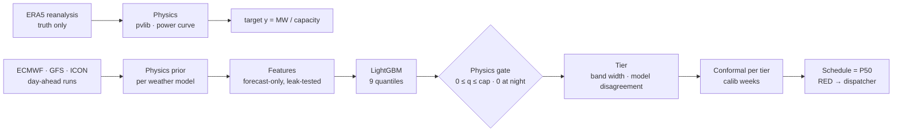

<div align="center">

# UrjaDrishti ಊರ್ಜಾ ದೃಷ್ಟಿ

**Day-ahead solar and wind forecasts for Karnataka that say how sure they are, hour by hour**

*Real archived ECMWF · GFS · ICON forecasts → physics → LightGBM quantiles → per-tier conformal bands → a schedule a dispatcher reviews only where it matters*

`offline after one fetch` · `runs on an Arm CPU` · `sealed unseen sites, scored once` · `checked against measured output` · `12 invariant tests`

</div>

---

## Why it exists

Every evening a Karnataka renewable generator files tomorrow's hour-by-hour schedule with the state load
despatch centre. Under the CERC deviation settlement rules, energy delivered outside a tolerance band around
that schedule is charged. The forecast behind the schedule is usually one number per hour, with no
sign of whether it will be close or wildly wrong.

Most of the money is lost in a small share of hours: monsoon afternoons when convective cloud arrives
earlier than forecast, or wind ramps that the weather models time differently. In v2's sealed test year,
**the 17–22% of hours this system marked RED held 72–76% of all the energy outside the band.**
A dispatcher who knew which hours those were could spend their attention there.

## What it does

| Capability | What it means |
|---|---|
| Real forecast inputs | The model only sees what three global weather models (ECMWF IFS, GFS, ICON) had published by the real filing deadline (10:00 the day before, so 24–48 h ahead), from Open-Meteo's archive of past runs |
| Physics first | pvlib (sun position, irradiance transposition, cell temperature, inverter clipping) and a turbine power curve turn weather into MW before any learning |
| Full distribution | LightGBM predicts 9 quantiles (P10…P90) of generation per plant-hour, shifted toward a no-ML anchor (NWP mean or linear MOS) by a weight chosen out-of-fold |
| Honest bands | Conformalized quantile regression, calibrated **separately for each confidence tier** |
| Confidence tiers | GREEN / AMBER / RED per hour, from forecast-time signals only |
| Deterministic schedule | Filed schedule = P50; RED hours require a dispatcher. No model decides what gets filed |
| Edge path | A 30 KB quantile MLP exported to ONNX fp32/int8, benchmarked on Arm64 (Pi 5 script included) |
| Measured-output check | The same method on Belgian grid data (Elia), scored against measured output and Elia's own professional day-ahead forecast |
| Replay desk | Dashboard of every validation day (and the test year, now it is scored), hardest days first |

## How it works



The folder tree is the diagram: `urja/data → physics → features → models → uncertainty → decision → eval → edge → api`.

## The trap: the Flat-Band Trap

The obvious way to make an "80% band" is to calibrate it on all hours at once. On average it then covers
80%, so it looks right. But it borrows its coverage from easy hours: it is **too wide on calm hours and too
narrow on exactly the hours that cost money**. In the sealed test year, the single-calibration band covered
only 68% of RED solar hours and 73% of RED wind hours.

UrjaDrishti assigns each hour a tier *before* calibration, from things known when the forecast is made
(the raw band width and how far the three weather models disagree), then calibrates each tier on its own
calibration data (Mondrian conformal prediction). Every tier then lands near its target. Toggle it live in
the dashboard's *Flat-Band Trap* panel.

## Results

All errors are % of plant AC capacity; solar is scored on daylight hours only (counting night, where every
method is trivially right, would roughly halve every solar number). "Energy outside ±10% band" is a
deviation-settlement proxy: the share of capacity-hours by which the delivered energy misses the schedule
by more than the free band. Every number below is generated from `results/*.json` by
`scripts/readme_numbers.py`.

<!-- numbers:start (generated by scripts/readme_numbers.py; do not edit) -->
**v3 sealed slices, scored once** (forecasts as available at the real filing deadline, 24–48 h lead)

*Unseen sites: 4 Karnataka locations no model or design choice had seen, Apr 2025 – Oct 2026.*

| Site | Model nMAE | Best baseline (nMAE) | vs best | P10–P90 coverage | RED-hour coverage | RED share of hours |
|---|---|---|---|---|---|---|
| Raichur solar | **5.61%** | nwp_ensemble (6.13%) | **−8.5%** | 79.0% | 82.6% | 23% |
| Kalaburagi solar | **5.96%** | nwp_ensemble (6.49%) | **−8.1%** | 79.5% | 79.2% | 23% |
| Bagalkot wind | **4.51%** | linear_mos (4.78%) | **−5.8%** | 80.3% | 80.7% | 19% |
| Davanagere wind | **4.92%** | linear_mos (5.26%) | **−6.5%** | 80.0% | 76.5% | 20% |

*Measured output (Elia, Belgium), Nov 2025 – Oct 2026, against Elia's own day-ahead forecast issued 11:00 the day before.*

| Series | Model nMAE | Elia nMAE | Linear MOS nMAE | Quantile score model / Elia | Coverage model / Elia (target 80%) |
|---|---|---|---|---|---|
| Limburg solar (measured) | 3.76% | **3.15%** | 3.85% | 0.0246 / 0.0209 | 85.1% / 79.5% |
| Belgian offshore wind (measured) | 8.94% | **7.47%** | 10.55% | 0.0566 / 0.0480 | 74.9% / 76.2% |

**v3 dev checks** (development data; looked at while building v3)

| Check | Solar | Wind |
|---|---|---|
| Real filing deadline vs v2's ~24 h lead (nMAE, Nov 2025 – Oct 2026) | 4.96% → 5.36% | 4.37% → 4.57% |
| PVG_S1: model vs NWP ensemble, scored on ERA5 / on NASA POWER satellite | 5.63% vs 6.67% / 6.46% vs 7.20% | – |
| KPL_S1: model vs NWP ensemble, scored on ERA5 / on NASA POWER satellite | 5.50% vs 6.26% / 6.88% vs 7.08% | – |
| How far the two truths disagree with each other (nMAE) | 7.3%–7.6% | – |

<details><summary>v2 results (superseded: ~24 h lead and a 30-minute timestamp shift, see BUILD_LOG #12–13)</summary>

**Sealed test year, scored once** (2025-11-01 to 2026-10-31, n = 8,900 solar hours, 17,520 wind hours)

| | Model nMAE | Best baseline (nMAE) | NWP ensemble nMAE | CRPS model / NWP ens. | P10-P90 coverage (target 80%) | Energy outside ±10% band vs best baseline |
|---|---|---|---|---|---|---|
| solar | **5.23%** | nwp_ensemble (5.17%) | 5.17% | 0.0405 / 0.0423 | 82.0% | **−9%** |
| wind | **4.06%** | linear_mos (4.81%) | 8.33% | 0.0315 / 0.0587 | 79.4% | **−32%** |

| Tier (per-tier calibration) | solar: share of hours · coverage · share of out-of-band energy | wind: share of hours · coverage · share of out-of-band energy |
|---|---|---|
| GREEN | 45% · 80.4% · 2% | 59% · 77.5% · 5% |
| AMBER | 34% · 83.9% · 22% | 25% · 80.5% · 23% |
| RED | 22% · 82.3% · 76% | 17% · 84.3% · 72% |

| Ablation (coverage in RED hours / nMAE) | solar | wind |
|---|---|---|
| full model, per-tier calibration | 82.3% / 5.23% | 84.3% / 4.06% |
| one calibration for all hours (the trap) | 68.3% / 5.23% | 72.7% / 4.06% |
| without NWP-disagreement features | 81.2% / 5.19% | 82.3% / 4.09% |
| ICON only (1 weather model, not 3) | 72.1% / 5.80% | 82.7% / 4.11% |
| without the physics prior | 81.1% / 5.38% | 82.2% / 4.12% |

**Validation (design choices were made looking at this)** (2025-04-01 to 2025-11-01, n = 5,453 solar hours, 10,272 wind hours)

| | Model nMAE | Best baseline (nMAE) | NWP ensemble nMAE | CRPS model / NWP ens. | P10-P90 coverage (target 80%) | Energy outside ±10% band vs best baseline |
|---|---|---|---|---|---|---|
| solar | **6.03%** | linear_mos (6.50%) | 7.35% | 0.0469 / 0.0595 | 78.3% | **−11%** |
| wind | **5.62%** | linear_mos (6.94%) | 11.48% | 0.0442 / 0.0809 | 78.6% | **−30%** |

| Tier (per-tier calibration) | solar: share of hours · coverage · share of out-of-band energy | wind: share of hours · coverage · share of out-of-band energy |
|---|---|---|
| GREEN | 35% · 70.1% · 2% | 41% · 76.8% · 3% |
| AMBER | 38% · 81.3% · 28% | 27% · 79.0% · 19% |
| RED | 28% · 84.3% · 70% | 32% · 80.5% · 78% |

| Ablation (coverage in RED hours / nMAE) | solar | wind |
|---|---|---|
| full model, per-tier calibration | 84.3% / 6.03% | 80.5% / 5.62% |
| one calibration for all hours (the trap) | 74.8% / 6.03% | 70.3% / 5.62% |
| without NWP-disagreement features | 84.3% / 6.04% | 78.9% / 5.60% |
| ICON only (1 weather model, not 3) | 85.1% / 6.18% | 79.1% / 5.59% |
| without the physics prior | 84.8% / 6.09% | 77.3% / 5.61% |

**Edge benchmark: Apple M4** (arm64; Arm features: FEAT_DotProd, FEAT_I8MM, FEAT_BF16; 1 thread)

| | Model | Size | Latency per plant-day (24 h) | 10k rows | CRPS (val) |
|---|---|---|---|---|---|
| solar | LightGBM, 9 quantiles (Python API) | – | 7.49 ms | – | 0.0469 |
| solar | quantile MLP, ONNX fp32 | 30 KB | 21 µs | 2.55 ms | 0.0523 |
| solar | quantile MLP, ONNX int8 | 14 KB | 26 µs | 3.88 ms | 0.0517 |
| wind | LightGBM, 9 quantiles (Python API) | – | 7.02 ms | – | 0.0442 |
| wind | quantile MLP, ONNX fp32 | 30 KB | 21 µs | 2.53 ms | 0.0483 |
| wind | quantile MLP, ONNX int8 | 14 KB | 26 µs | 3.83 ms | 0.0497 |

</details>
<!-- numbers:end -->

### What the numbers say, plainly

- **Unseen sites:** at all four sites the model never saw, it beats the best no-ML baseline by 6–9%, and the
  P10–P90 band covers 79–80% of hours against an 80% target. RED-hour coverage is 76–83%.
- **Measured output:** on real Belgian grid data the method beats a linear correction of the weather models,
  but **Elia's own forecast is 16–20% better** on point error. Elia has far more information (many sites,
  in-house weather processing) than three free global models at one grid point. Our solar band is wider
  than needed (85% coverage); our offshore-wind band is a little narrow (75%).
- **Real filing deadline:** holding the model to a 10:00 deadline (24–48 h lead instead of ~24 h) costs
  about 4–8% in accuracy on dev data. That is the price of being honest about timing.
- **Second truth:** scored against NASA satellite data instead of ERA5, the model still beats the weather-model
  average at both solar sites, by 3–10% instead of 12–16%. The two truths disagree with each other by about
  7.5% of capacity, which is more than any model's error. Reanalysis "truth" has its own uncertainty.
- **Earlier findings (v2) that still hold:** per-tier calibration fixes the Flat-Band Trap; int8 makes the
  30 KB edge model smaller but not faster.

## Honest limits (read before the numbers)

- **Karnataka plant output is simulated.** Plant-level SCADA is not public, so "actual" generation is ERA5
  reanalysis weather run through the same physics model. The forecast error the model learns is real; plant
  behaviour (soiling, outages, curtailment, real turbine curves) is not. The Belgian check uses measured
  output, but Elia's solar "measured" values are upscaled from sampled installations.
- **Capacities are modelled 100 MW blocks** at real locations, not the real plants' nameplate.
- **One weather point per Belgian series.** A province and an offshore zone are represented by a single grid point.
- **The unseen sites share years and weather regimes** with the training sites. They test transfer across
  places, not across time. The Nov 2026+ slice is sealed for a later time test.
- **The deviation proxy is not rupees.** CERC's actual charges depend on frequency-linked rates and
  state-specific bands; we report energy outside a ±10% band only.
- **Publication latency is assumed** (6 h after a run starts). Real latency varies by model.
- **Edge numbers so far are from an Apple M4 (Arm64).** Raspberry Pi 5 numbers need `scripts/bench_pi.sh`
  to be run on the board.

Full inventory: [`docs/HONESTY.md`](docs/HONESTY.md). Design and decisions: [`docs/BIBLE.md`](docs/BIBLE.md).
What went wrong along the way: [`docs/BUILD_LOG.md`](docs/BUILD_LOG.md).

## Run it

```bash
bash scripts/reproduce.sh                       # fetch, train, evaluate, bench, test, build the dashboard
.venv/bin/uvicorn urja.api.app:app --port 8000  # then open http://localhost:8000
```

After the first fetch (~2 minutes, public APIs, no keys) everything runs offline from `data/raw/`.
`python -m urja.eval.v3` writes the v3 dev report. The sealed v3 slices (see [`docs/V3_SEAL.md`](docs/V3_SEAL.md))
are scored by `python -m urja.eval.v3 --final`, which refuses to run a second time.

## Tests

`pytest` runs 12 named invariants, including:

| Test | Claim it protects |
|---|---|
| `test_no_truth_leaks_into_features` | Scrambling the truth data changes the target but not a single feature value |
| `test_splits_are_time_ordered_and_sealed` | train/calib < val < test, no overlap |
| `test_gate_never_emits_impossible_power` | Quantiles never cross, never leave [0, capacity], solar is 0 at night (300 generated cases) |
| `test_tier_is_monotone_in_uncertainty` | More uncertainty can never make an hour look safer (500 generated cases) |
| `test_api_hides_test_year_until_scored` | The dashboard cannot show the sealed year before it is scored |
| `test_filed_lead_never_uses_a_run_published_after_the_deadline` | No hour uses a weather run that wasn't published by 10:00 the day before (200 generated days) |
| `test_karnataka_rows_sit_on_true_utc_hours` | Regression for the 30-minute timestamp bug |

## History

v1 of UrjaDrishti was a five-person hackathon build (May 2026) on synthetic data. Its headline number
compared against persistence, and its "raw NWP" baseline was fitted on the *observed* weather of the hour
being forecast, so it beat the model by 5×. v2 rebuilt it from scratch on real archived forecasts.
v3 held it to the real filing deadline, fixed a 30-minute timestamp bug that a second, independent truth
exposed, tested it on four unseen sites and on measured Belgian output, and sealed both before writing any
code (`docs/V3_SEAL.md`). Earlier versions are preserved in git history.
